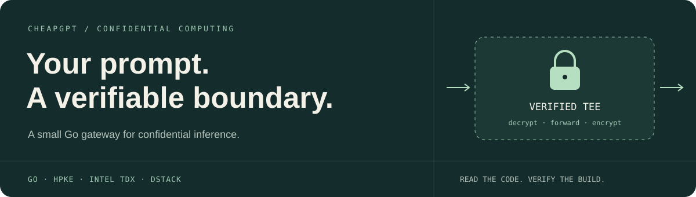
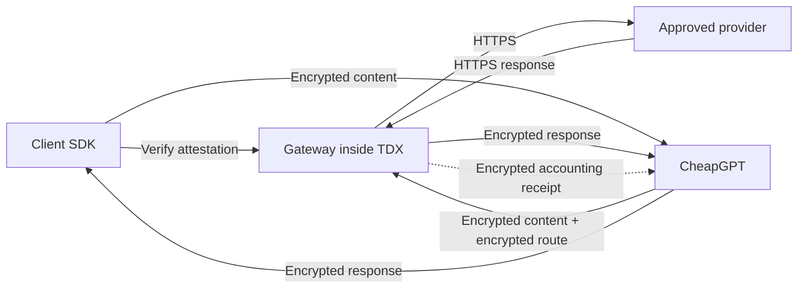

<p align="center">
  
</p>

<p align="center">
  <a href="https://github.com/kitbuilder587/cheapgpt-confidential-gateway/actions/workflows/ci.yml"></a>
  
  
  <a href="LICENSE"></a>
</p>

<p align="center">
  <a href="#how-it-works">Architecture</a> ·
  <a href="#quick-start">Quick start</a> ·
  <a href="docs/protocol.md">Protocol &amp; SDK</a> ·
  <a href="docs/deployment.md">Deploy to Phala</a> ·
  <a href="docs/security.md">Trust model</a>
</p>

# Confidential Gateway

A Go service that decrypts requests inside an attested Intel TDX environment, forwards them to an approved provider, and encrypts responses back to the client. CheapGPT keeps account selection, quotas and billing without receiving plaintext prompts or responses.

**Status: implemented for integration; live Phala acceptance and independent security review are pending.** The repository includes a working encrypted relay and tests, not a claim that an unaudited deployment is already safe for production secrets.

## What is included

| Capability | Implementation |
|---|---|
| Request confidentiality | Standard-library HPKE: X25519, HKDF-SHA256, AES-256-GCM |
| Response confidentiality and integrity | A fresh, encrypted 256-bit response key; ordered AES-GCM frames; authenticated end marker |
| Client verification | Intel quote signature and revocation checks, approved boot measurements, replayed application measurements, challenge and key binding |
| Restricted egress | Compiled host/path policy, approved headers, public-IP validation, HTTPS, no redirects or environment proxies |
| Streaming | Byte-preserving encrypted transport for JSON, SSE and binary provider streams |
| Accounting | Optional encrypted receipt with status, byte count and available provider token counters |
| Tokenization | Embedded `cl100k_base` and `o200k_base` vocabularies; Vercel token-count route |
| Operations | Bounded sessions and concurrency, cancellation, deadlines, graceful shutdown, aggregate metrics |
| Packaging | Static Go binaries, minimal container, Phala Compose template, pinned dependencies and CI |

No request database. No prompt cache. No request or response logging. No external quote-verification service: the Go client verifies Intel evidence locally, fetching only Intel's signed collateral.

## How it works



1. The client sends a fresh challenge. The gateway creates a short-lived, single-use encryption key inside the TEE and binds it to an attestation.
2. The SDK verifies the hardware, approved boot and application measurements, egress policy and challenge **before encrypting anything**.
3. The client seals its content and chosen destination host. CheapGPT independently seals the route and credentials to the same verified session.
4. The gateway rejects a different destination, decrypts inside the TEE and performs one upstream request. It never automatically retries a generation.
5. The client verifies and decrypts each response frame. An interrupted stream cannot be mistaken for a successful, complete response.

The gateway accepts **upstream-native JSON**. Provider-specific body construction belongs in the client integration; any future content transformation on the server must stay inside the measured TEE. A destination entry is transport permission, not a guarantee that every provider operation or authentication flow has been integration-tested.

## Destinations

All upstream requests use `POST` over HTTPS on port 443. The list is compiled into the image and its digest is bound to the session proof.

| Provider | Host | Path |
|---|---|---|
| Codex | `chatgpt.com` | `/backend-api/codex/responses` |
| Claude Code / Anthropic | `api.anthropic.com` | `/v1/messages`, with optional `beta=true` |
| Antigravity | `daily-cloudcode-pa.googleapis.com` | `/v1internal:streamGenerateContent`, with optional `alt=sse` |
| OpenRouter | `openrouter.ai` | `/api/v1/responses`, `/api/v1/chat/completions`, `/api/v1/completions` |
| Vercel | `ai-gateway.vercel.sh` | `/v1/messages/count_tokens` |
| Kiro | `runtime.us-east-1.kiro.dev` | Any canonical path; no query parameters |

The client commits to one destination host. A router cannot silently substitute another allowed provider. Arbitrary subdomains, alternate ports, redirects and private network destinations are rejected.

## Quick start

Requires **Go 1.26.8 or later**. HPKE is provided by Go itself. Docker is needed only for image builds.

```sh
git clone https://github.com/kitbuilder587/cheapgpt-confidential-gateway.git
cd cheapgpt-confidential-gateway
make build
make check
./bin/cgw policy-hash
```

Tests run locally with synthetic evidence and upstreams. The production server requires `/var/run/dstack.sock`; it has no simulator switch or unverified fallback.

For a deployed, independently approved gateway:

```sh
printf '%s' '{"model":"your-model","input":"Hello","store":false}' |
  ./bin/cgw request \
    --gateway https://your-gateway.example \
    --policy approved-policy.json \
    --host openrouter.ai \
    --path /api/v1/responses
```

Provide `GATEWAY_AUTH_TOKEN` and `UPSTREAM_TOKEN` through your local secret manager. `--headers` accepts an optional local JSON file for additional approved provider headers. Neither token belongs in command arguments or committed files. The CLI combines client and router roles for testing; the application integration keeps these roles separate.

Local text tokenization inside the TEE:

```sh
printf '%s' 'Hello world' |
  ./bin/cgw tokenize \
    --gateway https://your-gateway.example \
    --policy approved-policy.json \
    --encoding o200k_base
```

These counts cover the supplied text only. Message wrappers, tools, images and provider-specific accounting can differ. No tokenizer downloads vocabularies at runtime.

## Verification, not a badge

Copy `deploy/policy.example.json` to a local, ignored `approved-policy.json` and replace every placeholder with independently approved measurements. Do not copy measurements from an untrusted session and call that verification.

The client requires an approved `MRTD`, `RTMR0–2` and app Compose hash. It checks the quote's Intel chain and revocation collateral, rejects debug mode, replays dstack's runtime log and binds the session key to the client's fresh challenge. A code or configuration update must be reviewed and approved again.

```sh
./bin/cgw verify \
  --policy approved-policy.json \
  --evidence evidence.json \
  --challenge "$ORIGINAL_CHALLENGE_HEX"
```

See [security](docs/security.md) for assumptions and [deployment](docs/deployment.md) for the approval process.

## Run on Phala Cloud

Start with **2 vCPU / 4 GB**, Intel TDX, dstack. The planning estimate is **about $90/month** for one continuously running instance and a 20 GB disk, excluding model charges, tax and additional traffic. The gateway needs no GPU. Confirm current rates in [Phala's pricing](https://phala.com/pricing).

The [deployment guide](docs/deployment.md) covers an immutable image, encrypted secrets, client measurements and acceptance checks. Two replicas require session affinity because ephemeral keys stay in the instance that created them.

## Project map

```text
cmd/gateway/       production server
cmd/cgw/           verification and request CLI
attestation/       dstack socket client + local Intel TDX verification
protocol/          envelopes, response framing and accounting types
policy/            compiled destinations, headers and network rules
internal/gateway/  session lifecycle, encrypted relay and tokenization
sdk/               client and router integration helpers
deploy/            hardened Phala Compose and policy templates
docs/              protocol, deployment and security model
```

## Limits and remaining validation

- **Provider privacy:** approved providers, including OpenRouter and Vercel, receive plaintext when selected. Their retention policies and any downstream providers remain outside this gateway's attestation.
- **Protocol compatibility:** provider payload adaptation, OAuth refresh, account proxies, browser TLS impersonation and provider-specific stream translation are not part of this repository. Validate each production route with an authorized account before enabling it.
- **Usage availability:** counters are extracted from supported JSON/SSE usage records. Binary streams, oversized usage records or absent counters produce `usage_available: false`; missing usage must not be billed as zero automatically.
- **Hardware acceptance:** no production measurement values, paid Phala instance or real upstream credentials are included. Live TDX verification, load testing and independent review remain release gates.

[Contributing](CONTRIBUTING.md) · [Security reports](SECURITY.md) · [MIT license](LICENSE)
